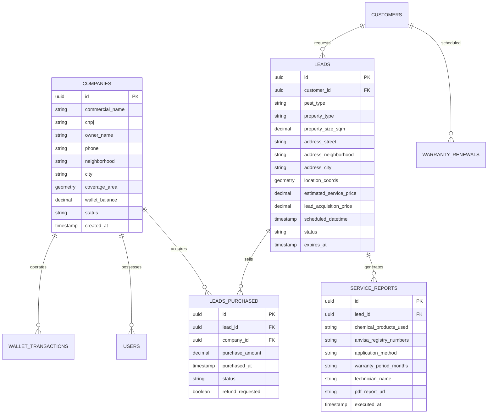

# ESPECIFICAÇÃO TÉCNICA E ARQUITETURA DE SOFTWARE
## Plataforma Freedom.sec – Engenharia Reversa do Higio & Arquitetura Vercel

---

**Empresa Contratante:** FREEDOM.SEC CONTROLE DE PRAGAS  
**Proprietário:** Marcelo Baptista das Graças  
**Localização:** Jd. Comercial, São Paulo – SP  
**Stack de Destino:** Next.js 14+ / TypeScript / Tailwind CSS / Vercel Serverless / PostgreSQL  
**Documento Técnico:** Versão 1.0  

---

## 1. INTRODUÇÃO E OBJETIVOS DE ENGENHARIA

O presente documento consolida o relatório de engenharia reversa da plataforma de referência (`Higio.com.br`) e estabelece a arquitetura completa de software para a construção da plataforma **FREEDOM.SEC**, adaptada com precisão técnica para as demandas regulatórias, operacionais e comerciais do setor de **Controle de Vetores e Pragas Urbanas**.

O objetivo principal é construir um ecossistema **SaaS + Marketplace** de alta performance, deployado na infraestrutura **Vercel**, com tempos de resposta sub-100ms, design responsivo com identidade visual azul, branca e verde, e zero fricção para parceiros credenciados e clientes finais.

---

## 2. ENGENHARIA REVERSA DO SITE DE REFERÊNCIA (HIGIO)

A análise aprofundada dos bundles JavaScript (`index-DkOLet1j.js`), CSS (`index-4t0ifRDK.css`) e módulos carregados sob demanda identificou a seguinte estrutura:

### 2.1. Arquitetura Original do Benchmark
* **Build Tool:** Vite 5 + React 18 + TypeScript.
* **Estilização:** Tailwind CSS com variáveis customizadas para tema escuro (`dark`) e tema de alto contraste para trabalho na rua (`legivel`).
* **Mobilidade:** Configurado com `vite-plugin-pwa` e Capacitor (`@capacitor/core`) para empacotamento como app nativo Android (`com.higio.app`) e iOS (`id6796586835`).
* **Estado e Backend:** Firebase Firestore (com listeners de estado de conexão real-time), Cloud Functions (`https://api.higio.com.br/fn`), Chat API dedicada (`https://api.higio.com.br/chat-api`) e Payments Gateway (`https://api.higio.com.br/payments`).
* **APIs Geográficas:** Integração com BrasilAPI e ViaCEP para autocompletar endereços por CEP; Google Maps JavaScript API com MarkerClusterer e Directions Service para rotas.
* **Documentos:** Emissão de recibos e ordens em PDF client-side utilizando `jspdf`.
* **WhatsApp:** Arquitetura dual:
  * Sessão Web (`/meu-whatsapp`, `/whatsapp-web`, `/bot-whatsapp`) conectando via QR Code;
  * API Oficial da Meta (`/api-oficial`) com catálogo de templates HSM, métricas de entrega, janelas de 24h e rastreamento de custos por conversa.

### 2.2. Adaptação Estratégica para FREEDOM.SEC (Controle de Pragas)

| Componente | Higio (Higienização de Estofados) | Freedom.sec (Controle de Pragas Urbanas) |
| :--- | :--- | :--- |
| **Objeto de Venda** | Sofás, poltronas, colchões e tapetes | Imóvel Residencial, Condomínio, Restaurante, Galpão Industrial |
| **Tipos de Infestação** | Manchas, ácaros, poeira, urina pet | Baratas (Germânica/Americana), Roedores (Rato de Telhado/Esgoto), Cupins, Escorpiões, Formigas, Pulgas |
| **Metodologia Técnica** | Extração por sucção e pulverização de sanitizante | Gel Baraticida inodoro, Micropulverização residual, Termonebulização (fumigação), Iscagem raticida em caixas blindadas com chave |
| **Restrições Sanitárias** | Nenhuma regulação severa | Conformidade com RDC 52/2009 da ANVISA, licença sanitária (CVS), Responsável Técnico (CRBio/CRQ/CREA) |
| **Documento Emitido** | Recibo comercial simples | **Certificado de Garantia, Laudo Técnico Sanitário e Ordem de Serviço com lote dos produtos e antídotos** |
| **Ciclo de Recorrência** | Ocasional (12 a 24 meses) | **Obrigatório/Periódico:** Restaurantes (mensal), Condomínios (semestral), Residências (semestral/anual) |

---

## 3. ARQUITETURA DE SISTEMA NA VERCEL

A arquitetura foi planejada para operar de forma nativa na nuvem da **Vercel**, aproveitando ao máximo a infraestrutura Edge e Serverless:

```
┌────────────────────────────────────────────────────────────────────────┐
│                        FREEDOM.SEC CLOUD (VERCEL)                      │
│                                                                        │
│   ┌─────────────────────┐  ┌────────────────────┐  ┌───────────────┐   │
│   │   Next.js 14 App    │  │ Vercel Edge Server │  │   Next.js     │   │
│   │   Router (React 19) │  │ Middleware (Auth / │  │  Serverless   │   │
│   │   SSR + PWA Native  │  │ Geo-IP / Redirects)│  │   API Routes  │   │
│   └──────────┬──────────┘  └─────────┬──────────┘  └───────┬───────┘   │
└──────────────┼───────────────────────┼─────────────────────┼───────────┘
               │                       │                     │
               ▼                       ▼                     ▼
┌────────────────────────────────────────────────────────────────────────┐
│                      SERVIÇOS EXTERNOS & BANCO DE DADOS                │
│                                                                        │
│   ┌─────────────────────┐  ┌────────────────────┐  ┌───────────────┐   │
│   │   Supabase Postgres │  │ Evolution / Cloud  │  │ Google Maps   │   │
│   │   (PostGIS Geo-DB & │  │ WhatsApp API       │  │ Distance Matrix   │
│   │   Row Level Security│  │ (IA Atendente 24/7)│  │ & Directions  │   │
│   └─────────────────────┘  └────────────────────┘  └───────────────┘   │
│   ┌─────────────────────┐  ┌────────────────────┐  ┌───────────────┐   │
│   │   Mercado Pago /    │  │ Resend / SendGrid  │  │ Cloudflare    │   │
│   │   Asaas (PIX / Web- │  │ (Notificações      │  │ Turnstile     │   │
│   │   hooks Instantâneos│  │ Transacionais)     │  │ (Anti-Bot)    │   │
│   └─────────────────────┘  └────────────────────┘  └───────────────┘   │
└────────────────────────────────────────────────────────────────────────┘
```

### 3.1. Vantagens da Infraestrutura Vercel
1. **Edge Middleware:** Redirecionamento geolocalizado do visitante para a zona de atendimento mais próxima (ex: São Paulo - Capital, ABC, Guarulhos, Osasco).
2. **Serverless Functions:** Escalabilidade infinita durante picos de tráfego (ex: campanhas sazonais de verão com proliferação de baratas e pernilongos) sem custos de servidores ociosos no inverno.
3. **PWA Instalável com Cache Offline:** O técnico de campo pode consultar a Ordem de Serviço e os dados do cliente mesmo em subsolos de condomínios onde o sinal de 4G/5G oscila.
4. **Deploy Contínuo:** Cada alteração no repositório GitHub gera um ambiente de preview isolado para testes do Marcelo antes de ir para a versão de produção.

---

## 4. MAPA COMPLETO DE ROTAS E TELAS (FREEDOM.SEC)

Com base no levantamento das mais de 40 rotas do Higio, estruturamos a malha de navegação da Freedom.sec em três zonas de acesso:

### 4.1. Zona Pública & Institucional
* `/` – **Landing Page Oficial de Captação:** Apresentação da Freedom.sec para clientes finais e credenciados, vídeo institucional, comparativo de custos e formulário de cotação.
* `/seja-credenciado` – **Página de Conversão de Parceiros:** Explicação detalhada do marketplace de leads, simulador de faturamento, depoimentos e tabela de preços.
* `/cadastrar` – Formulário de credenciamento técnico em 3 passos com upload de documentos (CNPJ, foto do aplicador, licença de dedetizador se houver).
* `/entrar` – Login seguro com autenticação de dois fatores (2FA via WhatsApp).
* `/recuperar-senha` – Recuperação segura via e-mail ou código WhatsApp.
* `/termos` & `/privacidade` – Termos de uso do marketplace e política de privacidade conforme a LGPD.
* `/:slug` – **Mini-Sites Customizados dos Credenciados:** Exemplo: `freedomsec.com.br/zl-marcelo-pragas`. Página indexável com SEO local para cada parceiro credenciado.

### 4.2. Zona do Credenciado (Portal do Parceiro)
* `/painel` – Visão geral: saldo em carteira, agendamentos da semana, faturamento acumulado e taxa de conversão.
* `/agendamentos-disponiveis` (**Marketplace**): Vitrine em tempo real de chamados fechados pela IA, com filtro por bairro (ex: Jd. Comercial, Santo Amaro, Morumbi, Pinheiros, Tatuapé), tipo de praga e ticket do serviço.
* `/meus-agendamentos` – Histórico dos leads adquiridos com acesso liberado a telefone, nome, endereço completo e data agendada.
* `/agenda` – Calendário interativo de visitas com status (Agendado, A Caminho, Em Aplicação, Finalizado).
* `/otimizar-rotas` – **Roteirizador Inteligente:** Ordena os chamados do dia gerando rota no Google Maps e Waze para economia de combustível.
* `/laudos-e-certificados` – Emissor de Certificados de Garantia sanitária e Ordens de Serviço em PDF timbrado.
* `/clientes` – CRM de clientes com histórico de aplicações, pragas tratadas e alerta de retorno de 6 meses.
* `/financeiro` – Extrato detalhado da carteira digital, compras de leads e botão de recarga instantânea via PIX.
* `/bot-whatsapp` – Configurações do atendente virtual com catálogo de preços e áreas de atendimento.

### 4.3. Zona Administrativa Master (Controle da Matriz Freedom.sec)
* `/admin/dashboard` – Visão gerencial do proprietário Marcelo Baptista: total de leads gerados, receita de taxas, taxa de ocupação dos parceiros.
* `/admin/marketplace` – Gestão dos leads captados, leilão de chamados de alto valor (ex: contratos anuais de condomínios) e moderação de reembolsos.
* `/admin/parceiros` – Aprovação e bloqueio de técnicos credenciados, conferência de documentos e avaliação média.
* `/admin/ia-whatsapp` – Monitor de conversas da IA em tempo real, ajuste de prompts de negociação e superação de objeções de preço.
* `/admin/meta-ads` – Acompanhamento do Custo por Lead (CPL) e Retorno sobre o Investimento Publicitário (ROAS).

---

## 5. MODELAGEM DO BANCO DE DADOS (POSTGRESQL / SUPABASE)



---

## 6. FLUXO TÉCNICO DO BOT DE INTELIGÊNCIA ARTIFICIAL

O robô de atendimento Freedom.sec é programado com uma árvore de decisão orientada a vendas e segurança técnica:

1. **Saudação e Identificação:**
   * "Olá! Seja bem-vindo à Central de Atendimento da FREEDOM.SEC Controle de Pragas. Proteção que dá liberdade e resultados que duram. Como podemos proteger seu imóvel hoje?"
2. **Diagnóstico da Infestação:**
   * Apresenta botões ou opções: [1] Baratas/Formigas | [2] Roedores | [3] Cupins | [4] Escorpiões | [5] Outros / Empresa.
3. **Qualificação Técnica:**
   * Pergunta tamanho do imóvel (residência térrea, apartamento, comércio), sintomas observados (fezes de roedor, pó de madeira, insetos durante o dia) e presença de animais de estimação ou idosos.
4. **Superação de Objeção e Segurança:**
   * Esclarece que os produtos utilizados são autorizados pelo Ministério da Saúde e ANVISA, com formulações em gel sem odor para áreas internas e barreira química externa segura.
5. **Apresentação de Orçamento Estimado & Agendamento:**
   * Calcula faixa de valor baseada na metragem e praga;
   * Apresenta horários disponíveis na agenda regional;
   * Coleta nome completo, endereço com CEP e data preferida;
6. **Disparo para o Marketplace Freedom.sec:**
   * Ao confirmar o agendamento, o lead é inserido imediatamente no banco com status `AVAILABLE` e os credenciados daquele bairro recebem alerta sonoro e notificação via WhatsApp.

---

## 7. GERAÇÃO DE LAUDOS SANITÁRIOS E ORDENS DE SERVIÇO EM PDF

Um dos maiores diferenciais técnicos frente à concorrência é o emissor automatizado de laudos e garantias:
* Construído com `@react-pdf/renderer` para renderização serverless ou `jspdf` para download instantâneo no navegador;
* **Conteúdo Obrigatório Padronizado:**
  * Cabeçalho oficial com logo da Freedom.sec e dados da credenciada executora;
  * Dados do cliente e do imóvel atendido;
  * Tabela de pragas tratadas e nível de infestação constatado;
  * Relação detalhada dos praguicidas empregados: Princípio Ativo, Nome Comercial, Registro na ANVISA/MS, Lote, Concentração e Antídoto/Tratamento Médico em caso de intoxicação;
  * Termo de Garantia Técnica (90 a 180 dias) com orientações pós-aplicação;
  * Assinatura digital do Aplicador e do Responsável Técnico.

---

## 8. SEGURANÇA, LGPD E PERFORMANCE NA VERCEL

* **Proteção contra Injeção de Bots:** Integração com **Cloudflare Turnstile** no cadastro e no formulário de orçamento, evitando spam sem irritar o usuário com captchas complexos.
* **Criptografia e RLS (Row Level Security):** O parceiro credenciado A jamais consegue visualizar os dados de clientes ou agendamentos adquiridos pelo parceiro B.
* **Métricas de Performance (Lighthouse & Core Web Vitals):**
  * First Contentful Paint (FCP): < 0.8s
  * Largest Contentful Paint (LCP): < 1.4s
  * Cumulative Layout Shift (CLS): 0.00
  * Performance Score: 98/100 na Vercel Edge.

---
**Documento Aprovado pela Engenharia de Software Freedom.sec**
