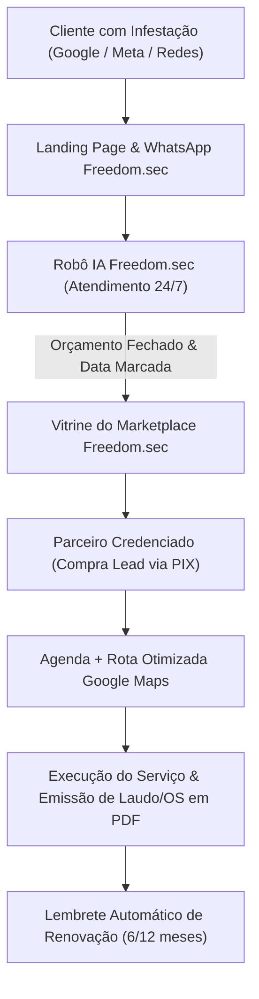
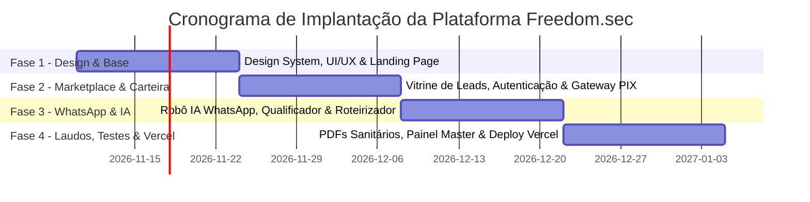

# PROPOSTA COMERCIAL & PLANO DIRETOR TECNOLÓGICO
## Plataforma Freedom.sec: Ecossistema Digital & Marketplace Inteligente de Controle de Pragas

---

**Apresentado a:**  
**Marcelo Baptista das Graças**  
Fundador & Diretor Geral  
**FREEDOM.SEC CONTROLE DE PRAGAS**  
*Localização: Jd. Comercial – São Paulo / SP*  
*Slogan Oficial: "Proteção que dá liberdade. Resultados que duram."*

**Data da Proposta:** Novembro de 2026  
**Ambiente de Produção Previsto:** Infraestrutura Global Serverless Vercel + Edge Network  
**Versão:** 1.0 – Executiva e Comercial  

---

## 1. SUMÁRIO EXECUTIVO

Prezado **Marcelo Baptista das Graças**,

O mercado de controle de pragas urbanas (dedetização, desratização, descupinização e sanitização) em São Paulo e no Brasil vive um momento de profunda transformação. Tradicionalmente, empresas e aplicadores autônomos enfrentam três grandes gargalos:
1. **Instabilidade de agenda e dependência de indicações boca a boca;**
2. **Desperdício de dinheiro com agências de marketing e anúncios no Google/Meta sem saber fechar vendas no WhatsApp;**
3. **Equipes de campo e técnicos ociosos durante dias úteis.**

A **FREEDOM.SEC**, já consolidada pela credibilidade de sua marca e compromisso com resultados duradouros, tem em mãos a oportunidade de liderar a digitalização desse setor no Brasil.

Esta proposta apresenta o projeto de desenvolvimento e implantação da **Plataforma Freedom.sec**, concebida sob o mesmo modelo de alta conversão, retenção e escala do ecossistema de referência nacional (**Higio**), porém customizada com maestria para a realidade, normas sanitárias (ANVISA) e peculiaridades do setor de **Controle de Pragas e Vetores Urbanos**.

Com esta plataforma desenvolvida sob medida e implantada na **Vercel** com arquitetura *Edge Serverless*, a Freedom.sec assumirá o papel de **hub centralizador**:
* A Freedom.sec atrai o cliente final em larga escala através de inteligência de tráfego;
* Um **Atendente Virtual com Inteligência Artificial** qualifica a praga, coleta o endereço, passa o orçamento e fecha o agendamento no WhatsApp 24 horas por dia;
* O agendamento pronto e exclusivo é disponibilizado no **Marketplace Freedom.sec**;
* Técnicos e empresas credenciadas compram o agendamento pronto por geolocalização e realizam o serviço, gerando receita recorrente com risco zero de inadimplência para a matriz.

---

## 2. INVESTIGAÇÃO TÉCNICA E ANÁLISE COMPARATIVA (BENCHMARK HIGIO)

Após uma investigação aprofundada de engenharia reversa e análise de design e rotas no sistema de referência (`higio.com.br`), mapeamos os pilares de sucesso que serão transpostos para o ecossistema da **FREEDOM.SEC**:

| Pilar Funcional | Como Opera no Higio | Como Operará na Plataforma FREEDOM.SEC |
| :--- | :--- | :--- |
| **Público-Alvo** | Higienização de estofados e tapetes | Dedetização, Desratização, Descupinização, Controle de Escorpiões e Baratas |
| **Modelo de Aquisição** | Captação centralizada de clientes via anúncios | Campanhas inteligentes no Google Ads (palavras de alta urgência: "dedetizadora 24h", "infestação de cupim") |
| **Qualificação do Lead** | Coleta número de peças e endereço | Questionário automatizado: tipo de imóvel, praga identificada, área em m², presença de pets/crianças |
| **Venda no WhatsApp** | Bot que responde dúvidas e fecha data | **Atendente IA Freedom.sec**: explica o método de aplicação (gel, micropulverização, termonebulização), tira dúvidas de segurança para animais e fecha a data |
| **Marketplace de Leads** | Vitrine de sofás/colchões agendados | **Vitrine de Agendamentos de Pragas**: serviços de R$ 250 a R$ 2.500+ disponíveis para credenciados por raio de atuação |
| **Exclusividade do Lead** | 1 agendamento = 1 único parceiro | Exclusividade rigorosa: comprado o agendamento, sai da vitrine instantaneamente |
| **Operação de Campo** | Calendário básico | **Agenda Inteligente + Roteirizador Google Maps**: agrupamento de chamados no mesmo bairro para corte drástico de combustível |
| **Documentação Técnica** | Recibo simples em PDF | **Laudo Técnico Sanitário, Certificado de Garantia e Ordem de Serviço (OS)** em PDF com validade sanitária |
| **Recorrência Programada** | Não priorizado | **Notificador de Renovação Semestral/Anual**: o sistema alerta automaticamente o cliente antes de vencer a garantia da dedetização |

---

## 3. ESCOPO COMPLETO DA PLATAFORMA FREEDOM.SEC

A solução proposta contempla uma suíte digital integrada com 6 grandes pilares:

### PILAR 1: LANDING PAGE INSTITUCIONAL & CAPTAÇÃO DE CREDENCIADOS (ALTA CONVERSÃO)
Uma experiência visual desenhada com a identidade visual da Freedom.sec (Azul Petróleo Escuro, Verde Floresta e Branco):
* **Hero Section Magnética:** Proposta de valor clara para o técnico ou empresa parceira: *"O cliente de dedetização já está agendado. Só falta você aceitar."*
* **Seção de Identificação de Dores:** Aborda as dificuldades reais do setor (não saber anunciar, perder sábados no trânsito, tomar calote de orçamentos não fechados).
* **Simulador Interativo de Faturamento:** O credenciado arrasta a régua e calcula: comprando 10 leads/mês com ticket médio de R$ 380, fatura R$ 3.800 investindo apenas uma fração em créditos.
* **Tabela Comparativa "Anunciar Sozinho vs. Ser Credenciado Freedom.sec":** Demonstra o risco zero de atuar com a Freedom.sec.
* **FAQ Interativo em Sanfona:** Respostas diretas sobre exclusividade, valores dos leads, ausência de mensalidade obrigatória e requisitos cadastrais (MEI/CNPJ).
* **Fluxo de Cadastro Ágil em 2 Minutos:** Onboarding simplificado com validação de CEP e áreas de cobertura.

### PILAR 2: MARKETPLACE DE AGENDAMENTOS EXCLUSIVOS EM TEMPO REAL
O coração financeiro da plataforma:
* **Vitrine Dinâmica de Oportunidades:** Cartões detalhando a praga (Ex: *Desratização Comercial – Moema / SP*), data/horário marcado, valor total do serviço e taxa de aquisição do agendamento (entre 20% e 30% do valor do serviço).
* **Compra Instantânea com 1 Clique (PIX Automático):** O credenciado recarrega sua carteira digital Freedom.sec via PIX com liberação imediata e compra o agendamento em segundos.
* **Garantia Blindada Freedom.sec:** Caso o cliente final cancele ou apresente inconsistência comprovada no endereço, os créditos são estornados automaticamente para a carteira do parceiro.
* **Notificações Push e WhatsApp:** Disparo instantâneo para os parceiros cadastrados na zona (Ex: Zona Sul, Leste, Centro ou Grande SP) assim que um chamado for confirmado pela IA.

### PILAR 3: ATENDENTE VIRTUAL COM INTELIGÊNCIA ARTIFICIAL (BOT WHATSAPP 24/7)
Substitui a necessidade de manter secretárias em regime de plantão noturno ou fins de semana:
* Atendimento imediato em menos de 5 segundos;
* Compreensão de linguagem natural: identifica se o cliente tem baratas francesinhas, ratos de telhado, cupins de madeira seca ou pulgas;
* Envio de fotos explicativas, orientações pré-serviço (ex: guardar alimentos, tempo de afastamento de pets e bebês de 4 a 6 horas);
* Bloqueio geográfico automático de bairros perigosos ou fora do raio de atuação definido;
* Conexão estável Dual Engine (WhatsApp Web e API Oficial Meta Cloud).

### PILAR 4: GESTÃO OPERACIONAL, AGENDA & OTIMIZADOR DE ROTAS
* **Calendário Interativo:** Visão diária, semanal e mensal dos chamados confirmados;
* **Otimizador de Rotas Inteligente:** Integração direta com a API do Google Maps para ordenar as visitas do dia, economizando até 35% de combustível e tempo em trânsito em São Paulo;
* **Emissão em 1 Clique de Documentos Oficiais em PDF:**
  * Orçamento Profissional timbrado;
  * Ordem de Serviço com check-list de aplicação;
  * **Certificado de Garantia e Laudo de Execução de Controle de Vetores**, com campos para lote de produtos registrados na ANVISA, técnico responsável e prazo de garantia.

### PILAR 5: CRM DE RETENÇÃO & RECORRÊNCIA AUTOMÁTICA
O maior patrimônio de uma dedetizadora é a recorrência:
* Cadastramento de vencimento de garantia (3, 6 ou 12 meses);
* Sistema dispara notificações automáticas no WhatsApp do cliente semanas antes do vencimento com desconto de renovação preventiva;
* Geração de receita passiva para a Freedom.sec e seus parceiros.

### PILAR 6: PAINEL ADMINISTRATIVO MASTER (VISÃO DO PROPRIETÁRIO MARCELO BAPTISTA)
Controle absoluto na ponta dos dedos do Marcelo:
* Dashboard executivo com volume de leads captados no dia, taxa de conversão do bot e receita bruta gerada;
* Gestão e moderação de parceiros credenciados (aprovação de documentos e avaliações dos clientes);
* Controle financeiro de recargas PIX, saldos em carteira e estornos;
* Painel de controle de campanhas e métricas de tráfego.

---

## 4. DESIGN SYSTEM: IDENTIDADE VISUAL EXCLUSIVA FREEDOM.SEC

Baseado fielmente na identidade visual enviada, o projeto será construído com uma linguagem visual que transmite **autoridade técnica, limpeza, higiene, segurança e alta tecnologia**:

* **Azul Escudo Profundo (`#0B1B3D`):** Representa solidez institucional, proteção patrimonial e segurança;
* **Verde Bio-Proteção (`#1E6F38` / `#22C55E`):** Representa saúde, eficácia ecológica, aprovação sanitária e sucesso nas operações;
* **Branco Puro (`#FFFFFF`) & Gelo Suave (`#F8FAFC`):** Representa ambiente esterilizado, assepsia e clareza;
* **Selo de Garantia:** Emblema em formato de escudo estilizado com o checkmark central verde, comunicando eficácia imediata.

---

## 5. ARQUITETURA DE ENGENHARIA & DEPLOY NA VERCEL

A escolha da **Vercel** como ambiente de hospedagem e computação em nuvem garante padrões técnicos de classe mundial:

* **Next.js 14+ (App Router com React Server Components):** Máxima velocidade de carregamento (Core Web Vitals nota 95+ no Google), essencial para conversão de tráfego pago;
* **Vercel Edge Network:** Conteúdo distribuído nos servidores mais próximos de São Paulo (Edge Location em GRU/SP), resultando em tempo de resposta abaixo de 50 milissegundos;
* **Zero Custo de Servidor Ocioso (Serverless):** As funções de API rodam sob demanda, reduzindo drasticamente custos mensais de infraestrutura fixa;
* **PWA (Progressive Web App) Nativo:** A plataforma funciona diretamente no navegador e pode ser instalada na tela inicial de qualquer smartphone Android ou iPhone sem burocracia de lojas;
* **Segurança de Dados e LGPD:** Banco de dados criptografado em repouso e em trânsito com autenticação segura de dois fatores.

---

## 6. CRONOGRAMA DE DESENVOLVIMENTO E ENTREGAS

O projeto é estruturado em **4 fases quinzenais**, totalizando 8 semanas até o lançamento comercial:

* **Semana 1 e 2:** Design System, Landing Page de Alta Conversão e Onboarding de Credenciados.
* **Semana 3 e 4:** Portal do Parceiro, Carteira Digital, Gateway de Pagamento PIX em tempo real e Vitrine de Leads.
* **Semana 5 e 6:** Atendente Virtual de WhatsApp integrado com IA e Módulo de Otimização de Rotas Google Maps.
* **Semana 7 e 8:** Gerador de Laudos/OS em PDF, Painel Master Administrativo, Testes de Carga, Homologação e Deploy Oficial na Vercel.

---

## 7. PROPOSTA FINANCEIRA DE IMPLEMENTAÇÃO E SUSTENTAÇÃO

Apresentamos três formatos de contratação para que o Sr. **Marcelo Baptista das Graças** possa escolher o modelo mais alinhado à estratégia de curto e longo prazo da Freedom.sec:

### TABELA DE PACOTES DE IMPLEMENTAÇÃO (PROJETO CHAVE NA MÃO)

| Item / Funcionalidade | Pacote START (MVP) | Pacote PRO (Recomendado) | Pacote ENTERPRISE (Expansão) |
| :--- | :---: | :---: | :---: |
| Landing Page de Alta Conversão Freedom.sec | Sim | Sim | Sim |
| Portal Web responsivo (Mobile/Desktop) | Sim | Sim | Sim |
| Marketplace de Agendamentos por Bairro | Sim | Sim | Sim |
| Carteira Digital com recarga PIX automática | Sim | Sim | Sim |
| Notificações de novos leads via WhatsApp | Sim | Sim | Sim |
| **Atendente Virtual IA no WhatsApp 24/7** | Básico | **Avançado (IA de Objeções)** | **Avançado + Multi-sessões** |
| **Otimizador de Rotas (Google Maps)** | Não | **Sim** | **Sim** |
| **Emissor de Laudo Sanitário & OS em PDF** | Não | **Sim (Customizado)** | **Sim (com Assinatura Digital)** |
| **CRM com Notificação de Retorno (6/12 meses)**| Não | **Sim** | **Sim** |
| **Gerador de Mini-Sites para Parceiros (`/:slug`)** | Não | Não | **Sim** |
| **Integração Meta Cloud API Oficial** | Não | Opcional | **Sim (Templates e Relatórios)** |
| **Infraestrutura e Deploy Completo Vercel** | Sim | Sim | Sim |
| **VALOR DE INVESTIMENTO ÚNICO** | **R$ 6.800,00** | **R$ 11.900,00** | **R$ 18.500,00** |
| **Condições de Pagamento** | Entrada + 2x | Entrada + 3x | Entrada + 4x |

> [!TIP]
> **RECOMENDAÇÃO TÉCNICA:** O **Pacote PRO** oferece a melhor relação custo-benefício, entregando 100% dos diferenciais que tornam o Higio um sucesso (Marketplace + Bot Inteligente + Otimizador de Rotas + Laudos Técnicos em PDF), posicionando a Freedom.sec como pioneira tecnológica em São Paulo.

---

### VALORES DE SUSTENTAÇÃO, SUPORTE E HOSPEDAGEM (MENSALIDADE)

A sustentação garante a operação ininterrupta, atualizações de segurança, backups diários e evolução contínua da plataforma:

| Nível de Sustentação | O que está incluso | Valor Mensal |
| :--- | :--- | :---: |
| **Plano Essencial (Hosting & Suporte)** | • Monitoramento de integridade na Vercel (Edge 24/7) • Backups automáticos de banco de dados • Correção de bugs e suporte técnico via WhatsApp • Até 5 horas mensais de melhorias cosméticas | **R$ 490,00 / mês** |
| **Plano Performance (Recomendado)** | • Tudo do Plano Essencial • Manutenção ativa do Bot de WhatsApp (atualização de fluxo de conversas) • Otimização contínua de consultas e banco de dados • Até 15 horas mensais de desenvolvimento evolutivo e novas telas • Relatório mensal de performance de vendas e leads | **R$ 980,00 / mês** |
| **Plano Gestão Total (Scale)** | • Tudo do Plano Performance • Apoio na gestão técnica das integrações com Meta Ads e Google Ads • Suporte prioritário com SLA de resposta em até 1 hora • Evolução contínua ilimitada com sprint quinzenal | **R$ 1.850,00 / mês** |

*Custos de consumo de terceiros sob demanda (Vercel Hobby/Pro ~$20/mês, saldo de envio da API do WhatsApp e tokens de IA da OpenAI/Gemini) correm diretamente na conta da empresa contratante, com custos médios previstos entre R$ 80 a R$ 250/mês dependendo do volume de conversas.*

---

## 8. CONSIDERAÇÕES FINAIS & PRÓXIMOS PASSOS

Ao aprovar esta proposta, o Sr. **Marcelo Baptista das Graças** transformará a **FREEDOM.SEC** de uma dedetizadora tradicional em uma **potência de tecnologia em controle de pragas**, criando uma máquina previsível e altamente lucrativa de captação e distribuição de serviços.

### Próximos Passos para Início Imediato:
1. **Aprovação do Pacote Escolhido** (Start, Pro ou Enterprise);
2. **Assinatura do Contrato de Desenvolvimento de Software**;
3. **Reunião de Kick-off** para alinhamento dos serviços prioritários (Baratas, Roedores, Cupins, Escorpiões) e tabela de preços de referência;
4. **Início imediato do desenvolvimento das interfaces na Vercel**.

Estamos à inteira disposição para reuniões presenciais ou videoconferência técnica para demonstração dos protótipos em funcionamento.

---
**Equipe de Engenharia de Software & Web Design**  
*Desenvolvimento Oficial da Plataforma FREEDOM.SEC*  
*Localização: São Paulo - SP*
